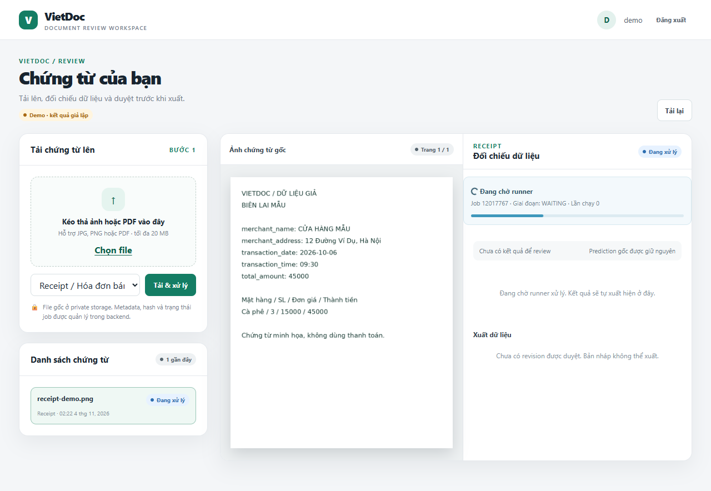

# BT cá nhân 3 – AI-02 – VT-030
Nguyễn Hoàng Hải – MSSV 23001870 – Vai trò: Nhóm trưởng.
Team: SE2026-T08. Đề tài: Document Intelligence cho biểu mẫu tiếng Việt.
Repository: [harivodich/SE2026-T08](https://github.com/harivodich/SE2026-T08).
Baseline develop: 729be6fe493dc00e1d7cb87e7db94b94c79a0816.
Branch: [codex/bt3-vt030-async-idempotency](https://github.com/harivodich/SE2026-T08/tree/codex/bt3-vt030-async-idempotency).
Source/tests sau review: a1055c300f2321ba64f0f46582348f63b258a542.
Ngày kiểm chứng: 04/11/2026 (UTC+7). URL SE2026.AI-02.1 trong đề là tên repo trước khi đổi tên.
Tôi chịu trách nhiệm về toàn bộ code, test và nội dung bài làm; tôi đã khai báo việc sử dụng AI.
## 1 - Specification và phạm vi thay đổi
Người dùng gửi ảnh chứng từ, hệ thống nhận job dài và cho theo dõi tiến trình. Nếu response bị mất, gửi lại cùng thao tác phải trả về job cũ, không tạo thêm công việc hoặc kết quả nghiệp vụ. Baseline đã có durable job, worker, retry và UI polling; increment cá nhân bổ sung Location trong response 202 để client biết URL theo dõi và kiểm chứng các invariant hiện có.
| AC | Acceptance criterion có thể kiểm thử |
|---|---|
| AC1 | POST hợp lệ trả 202, identity đúng, Location trỏ đúng GET job; monitor có state/stage và no-store, không chờ inference. |
| AC2 | Cùng document/key trả cùng job/run reservation và một CREATE_JOB; khác key khi đang active trả 409. Cùng key ở document khác độc lập. |
| AC3 | Retry/recover/cancel và completion lặp hoặc stale không tạo quá một committed run/JOB_COMPLETED cho logical job. |
| AC4 | Anonymous 401; foreign owner 404; thiếu CSRF 403; key sai 400; request bị từ chối không tạo job. |
| AC5 | Harness 200 client đồng thời: đủ 200 outcomes, 0 lỗi, p95 admission ≤ 5.000 ms. Công bố môi trường và giới hạn. |
### Constraints và invariant
- Java là bên ghi business DB; compute chạy ngoài web request/DB transaction. Không thêm queue hoặc model trong Java.
- Giữ body/schema, session/CSRF/ownership; chỉ thêm HTTP header. Không coi reserved result_run_id là kết quả đã tồn tại.
Invariant: cùng (document_id, request_key) chỉ một logical job/CREATE_JOB; duplicate hoặc stale completion không thêm committed run/audit hoàn tất. Đây là kiểm soát side effect, không phải exactly-once computation. Chưa có notification sender nên không nhận đã chứng minh gửi thông báo đúng một lần.
<!-- PAGE -->
## 2 - AI-assisted plan và review bằng source
Em dùng Codex để tổ chức increment, viết tests trước và chạy kiểm chứng; Claude lập plan read-only trước patch, sau đó phản biện evidence. AI không thay thế việc đọc diff hoặc sự chấp thuận cuối của người nộp. Prompt thực tế và các lần sửa oracle nằm ở phụ lục A.
### Plan trước implementation
1. Chốt baseline/branch riêng; đọc DocumentController, DocumentService, JobService, JobWorker, SecurityConfig và OpenAPI.
2. Sinh tests API/DB và mapping trước; chạy baseline, phân biệt lỗi harness, oracle sai và lỗi sản phẩm.
3. Thêm ResponseEntity 202 + Location ở createJob; giữ body, Security cache headers và GET; đồng bộ OpenAPI.
4. Chạy green, tạo mutant mapping trên nhánh tạm độc lập; lưu assertion fail và xác minh nhánh nộp còn source đúng.
5. Đo coverage, thử thứ tự tests, tải 200 client và Chrome/TCP; ghi giới hạn, README và traceability.
### Những điểm của plan AI được sửa hoặc bác bỏ
| Đề xuất ban đầu | Evidence và quyết định |
|---|---|
| Dựng thêm executor/queue mới | JobService và JobWorker đã có claim/lease/fence, scheduler và async executor. Giữ nguyên; tránh hai cơ chế điều phối. |
| Đặt result_run_id = null trước khi hoàn tất | OpenAPI Job yêu cầu string; JobService.create cấp UUID trước compute. Giữ reservation và kiểm persisted ExtractionRun riêng. |
| Thêm explicit CacheControl cho cả POST/GET | SecurityConfig đã trả no-cache, no-store, max-age=0, must-revalidate. Claude chỉ ra override có thể mất header sẵn có; bỏ phần patch dư thừa. |
| Dùng 5 giây làm SLA hoàn tất OCR | Worker/model/hardware không được đo trong harness. Chốt admission API; không suy ra inference hoặc PostgreSQL production SLA. |
### Patch và assumptions
Plan ban đầu dự kiến đổi createJob và GET monitor trong DocumentController.java, cập nhật openapi.json, thêm ba Vt030*Test. Sau review bỏ GET/CacheControl và không thêm queue. Production thực tế chỉ đổi DocumentController.java và openapi.json. Thêm ba lớp Vt030*Test, hai script mutation/browser và tài liệu riêng. Không đổi JobService, schema body, migrations hoặc UI. Location là URL tương đối; đọc monitor vẫn cần session của owner, không phải bearer capability.
Giả định key được giữ lại khi retry một thao tác. api.js hiện sinh key mới mỗi lần gọi createJob; test server và replay qua browser không chứng minh UI tự retry mất response. Đây là việc Web còn phải làm, không được che bằng test giả.
<!-- PAGE -->
## 3 - Risk strategy, partitions và test cases (1/2)
Unit bảo vệ semantic mapping với job/document/run IDs khác nhau. Integration/API đi qua Spring Security, controller, JPA/Flyway và H2, không mock JobService. Service tests kiểm claim/fence/transaction. E2E dùng Chrome, TCP và packaged JAR. Load riêng để đo admission, không lẫn thời gian chuẩn bị fixture.
Equivalence partitioning chia theo quyết định của hệ thống: key hợp lệ/vắng/sai/quá dài; same/different key và document; owner/foreign/anonymous; active/retrying/terminal; current/stale/expired claim. Mỗi lớp cần một representative có kết quả khác. Mapping lớp → case: valid/missing/malformed/overlong key → TC01/19, TC14, TC05, TC20; same/different key/document → TC03/04/09; owner/foreign/anonymous → TC01/08/07; active/retrying/succeeded/failed/cancelled → TC04/11/10/15/12; stale/expired claim → TC11/13; quota → TC21. Length 1/100/101 là kiểm biên bổ sung.
| ID | AC/risk; level | Precondition/input | Expected result | Pri. |
|---|---|---|---|---|
| TC01 | AC1/identity; API | Owner+CSRF, ảnh synthetic, key mới | 202; đúng doc/job, Location đúng; QUEUED; 0 run | P1 |
| TC02 | AC1/stale view; API | Poll job đã nhận | no-store, đúng document/state; không lease token | P1 |
| TC03 | AC2/lost response; API/DB | Gửi lại cùng doc/key | Cùng job/run reservation; 1 Job/CREATE_JOB | P1 |
| TC04 | AC2/duplicate; API/DB | Active job, key khác | 409; không insert thêm | P1 |
| TC05 | AC4/invalid key; API/DB | Key có space/slash | 400; 0 Job | P1 |
| TC06 | AC4/CSRF; API/DB | Có session, thiếu CSRF | 403; 0 Job | P1 |
| TC07 | AC4/privacy; API | Anonymous đọc monitor | 401; không lộ progress | P1 |
| TC08 | AC4/ownership; API/DB | Foreign owner đọc/tạo job | 404; số job không đổi | P1 |
| TC09 | AC2/key scope; service/DB | Cùng key, hai documents receipt/invoice | Hai job độc lập, mỗi doc 1 Job | P1 |
| TC10 | AC3/duplicate completion; service/API/DB | Complete hai lần, replay sau success | Lần hai false; 1 run/JOB_COMPLETED; không thêm audit | P1 |
Test data: samples receipt-demo.png/invoice-demo.png có sẵn trong repo, dùng chứng từ synthetic. API tests tạo user/document riêng mỗi case; unit mapping dùng ba UUID cố định khác nhau làm oracle độc lập. Receipt/invoice ở TC09 kiểm key scoping, không chứng minh model trích xuất tốt.
<!-- PAGE -->
## 3 - Risk strategy và test cases (2/2)
| ID | AC/risk; level | Precondition/input | Expected result | Pri. |
|---|---|---|---|---|
| TC11 | AC3/transient; service/API | Retryable failure, claim mới, old complete | RETRYING; old fence reject; new complete một lần | P1 |
| TC12 | AC3/cancel race; service/API | Cancel RUNNING, late complete | CANCELLED; 0 committed run | P1 |
| TC13 | AC3/lease; service/DB | Lease=Instant.EPOCH; recover/claim lại | Old token reject, new complete; 1 run | P1 |
| TC14 | AC2/no key; API/DB | Submit không key hai lần khi active | 202 rồi 409; 1 Job | P2 |
| TC15 | AC3/terminal; service/API | Permanent fail; replay original key | Cùng FAILED job, 0 run | P1 |
| TC16 | AC1/mapping; unit | 6 states, IDs job/doc/run khác nhau | document_id luôn là owning document | P1 |
| TC17 | AC5/fan-out; load API | 200 users/docs, barrier 200 | 200 responses/Jobs/CREATE_JOB, p95≤5s | P1 |
| TC18 | AC2/retry storm; load API | 200 client cùng owner/doc/key | Cùng ID; 1 Job/CREATE_JOB; 0 lỗi | P1 |
| TC19 | AC2/valid length; API | Key dài 1 và 100 | Cả hai accepted trên doc riêng | P2 |
| TC20 | AC4/overlong; API | Key dài 101 | 400; 0 Job | P2 |
| TC21 | AC2/quota; API | Owner có 5 active; tạo thứ 6/replay cũ | New 429; không insert; replay cũ 202 | P1 |
| E2E01 | AC1/UX; Chrome/TCP | Login/upload receipt; worker tắt | 202/Location; UI QUEUED và poll đúng | P1 |
| E2E02 | AC2/replay; browser API | Giữ session/key submit đầu | Same job, document detail cùng ID | P1 |
| E2E03 | AC3/status; Chrome/TCP | Cancel QUEUED qua session+CSRF | CANCELLED; progress active biến mất | P2 |
TC05–08/20 là negative tests; TC11/13/15 là failure paths. 21 case IDs tạo 27 JUnit invocations do TC16 có 6 states và TC19 có 2 độ dài; 3 browser checks được báo riêng, không cộng lặp những lần chạy lại.
Không cần retrain, payment, thêm notification provider hoặc lặp mọi UI case ở unit trong increment này. PostgreSQL locking, native OCR/model và crash thật vẫn cần integration về sau; H2 và cập nhật timestamp không thay thế các phép kiểm đó.
<!-- PAGE -->
## 4 - Test-first: fail → patch → pass
Baseline 729be6f đã có async worker và progress UI. Phần mới cần chứng minh là response có monitor URL đúng và không làm hỏng retry/ownership. Test-first commit 2d34f4c10cc4b8a692982be93ac0b4d6c6643d28 chưa chứa production patch.
| Lượt | Kết quả thực tế; phân loại |
|---|---|
| red (sandbox) | MSYS không khởi động; không tính là behavioral red. |
| red-native | 15 API/service tests (chưa chạy 6 unit), 2 failures: thiếu Location thật; cache header assertion quá chặt là lỗi test. |
| red-reviewed | Sửa cache oracle thành chứa directive no-store: 21 tests, 1 failure, 0 errors/skips. Chỉ TC01 fail vì Location null. |
| green | Sau patch và bổ sung key/quota cases: 25 tests, 0 failures/errors/skips. |
| full-coverage / final-full-coverage | Mỗi lượt 50 Java tests, 0 failures/errors/skips; JAR/JaCoCo đạt. 27 invocations mới VT-030; 23 baseline. Lượt cuối sau khi siết quota replay. |
Patch commit e3b3850000fa0a8f8f499bbc7ae7a88f06fdbc3d chỉ thêm monitor header trong flow hiện có:
```java
DocumentService.JobView job = jobs.create(id, user.id(), key);
return ResponseEntity.accepted()
    .location(URI.create("/api/v1/jobs/" + job.id()))
    .body(job);
```
### Mutation bắt buộc: đổi response-field mapping
Nhánh tạm codex/bt3-vt030-mapping-mutant, commit 09cd8a2169eade641bca2a4a426411736d37c029, đổi đúng một argument trong DocumentService.jobView: document_id lấy j.id thay vì j.documentId. Nhánh này chỉ local, không đưa vào nhánh nộp hoặc merge.
Chạy TC01 và 6 representatives TC16: JUnit XML ghi 7 tests, 7 failures do sai identity; không phải compile/setup error. TC01 dùng document ID được upload, TC16 dùng UUID cố định riêng; oracle không gọi lại chính mapper. Bug bị phát hiện ở unit và API boundary.
Experiment trước đó trên working copy cũng killed mutant và restore đúng SHA-256. Sau restore, full suite đạt. Experiment nhánh tạm độc lập không sửa nhánh nộp; hash mapper vẫn d99f5201…6f60f. Log/patch/commit và kiểm source unchanged có trong evidence/mutation-branch.*; đây là một mutant có chủ đích, không phải mutation score tổng quát. Tool sau review đọc fresh JUnit XML thay tìm chuỗi log; Windows mutation chạy lại 7 failures/0 errors và restore đúng hash (windows-mutation.*).
<!-- PAGE -->
## 5 - Coverage và thử tải 200 client
JaCoCo 0.8.14 đo trong lượt final-full-coverage gồm 50 tests trên source đúng; counters trùng lượt full-coverage ban đầu. Không gộp coverage từ mutant hoặc từ nhiều run không kiểm soát.
| Phạm vi | Line covered/total | Branch covered/total |
|---|---|---|
| Backend toàn bộ | 1.162/1.441 = 80,64% | 450/710 = 63,38% |
| JobService | 143/162 = 88,27% | 40/62 = 64,52% |
| DocumentController.createJob | 4/4 = 100% | N/A: không có branch counter |
| DocumentService.jobView | 1/1 = 100% | N/A: không có branch counter |
100% line ở mapper không đảm bảo mapping đúng: mutant vẫn đi qua dòng đó nhưng sai ý nghĩa. Semantic assertions bắt bug; risk coverage AC1–AC5 nằm ở trang 7. Phần branch chưa cover của JobService và controller/service khác vẫn là hạn chế của suite.
### Thiết kế harness và số đo
Máy Windows 11, Ryzen 7 8840HS, 8 cores/16 logical processors, RAM khoảng 15,21 GiB; Java 17.0.20.1+1, Spring Boot 3.5.16, H2 in-memory, Hikari pool 10. Seed user/session/document synthetic trước timer; worker tắt. 200 threads đứng ở ready latch rồi cùng release, đo nanoTime từng request qua MockMvc và Security/JPA thật. Deadline toàn đợt 60s; lỗi/timeout được giữ trong denominator. p95 là mẫu thứ ceil(0,95×200)=190 sau sắp tăng. barrier_ready/all_outcomes là flags khai báo; readiness/count được assertions kiểm, peak là số đo. Timer request bắt đầu khi thread thức; timeout tính từ release, nên chỉ so p95 khi đồng thời kiểm 0 lỗi như các run này.
| Run/JVM mới | 200 users/docs độc lập | 200 retry cùng key | Lỗi / peak inflight |
|---|---|---|---|
| load-repeat1 | p95 2.252,13 ms; 200 Jobs | p95 205,40 ms; 1 Job | 0 ở mỗi kịch bản; 200/200 |
| load-repeat2 | p95 2.244,73 ms; 200 Jobs | p95 222,96 ms; 1 Job | 0 ở mỗi kịch bản; 200/200 |
Cả hai kịch bản đạt ≤5.000 ms trong hai run chính; CREATE_JOB counts tương ứng 200 và 1. Raw JSON giữ đủ 200 outcomes/run/scenario. Lượt full-coverage ban đầu có instrumentation/warm-up khác cho 178,56/180,51 ms, retry peak 195; chỉ dùng như phép kiểm bổ sung, không chọn số nhanh nhất để báo SLA. Warm-up/thứ tự có thể ảnh hưởng chênh lệch, nhưng chưa tách thành thí nghiệm nhân quả; không kết luận chi phí riêng của mỗi scenario từ các số này.
Giới hạn: đây là admission harness, không phải 200 người dùng TCP hay 200 OCR hoàn tất. Timer loại login/upload/fixture prep; không có PostgreSQL production, native compute, GPU hoặc notification delivery. Chrome/TCP được kiểm chức năng riêng với một session, không phải TCP load test.
<!-- PAGE -->
## 6 - Traceability, flaky review và residual risk
A/M/L là ba Vt030*Test trong backend/src/test/java/vn/vietdoc/; B = scripts/vt030_browser.cjs. S = test-first 2d34f4c; P = patch e3b3850; R = siết assertions/tool a1055c3. S chứa TC01–18; P thêm TC19–21, audit assertions và B. Traceability ghi riêng phần bổ sung; không nhận mọi case đều có ở lần red. Full hashes/lệnh và diff lịch sử ở README/evidence.
| AC/risk | Test → file → commit | Evidence và giới hạn |
|---|---|---|
| AC1/monitor, mapping | TC01–02(A), TC16(M), E2E01(B); S/P | Red đúng Location; green API/unit; Chrome poll; mapping mutant bị bắt. |
| AC2/retry duplicate | TC03–04/09/14(A), TC18(L): S; TC19(A), E2E02(B): P; TC21(A): P/R | API/DB audit invariants và 200 same-key đạt; UI auto-retry chưa chứng minh. |
| AC3/recovery, late effects | TC10–13/15(A): S; E2E03(B): P | 1 committed run/audit; stale/cancel reject. Service simulation, chưa kill process thật. |
| AC4/access/input | TC05–08(A): S; TC20(A): P | 400/401/403/404 đúng, không insert; không thay thế security audit toàn app. |
| AC5/200 client ≤5s | TC17–18(L); S/P | 2 fresh-JVM runs đạt; raw outcomes và count DB; scope MockMvc/H2 admission. |
### Kiểm tra flaky tests
- Time: TC13 đặt lease quá hạn bằng Instant.EPOCH thay sleep; latency dùng monotonic nanoTime. Chưa kiểm clock skew giữa nhiều host.
- Order/shared state: mỗi API case có owner/doc riêng; hai JVM chạy JUnit method seeds 17 và 83 đều 25/25 pass. order-comparison.json xác nhận thứ tự case ghi trong XML của hai seed khác nhau và khác green; final-order-seed* kiểm lại sau R. Class-order seed ở log; hai lần chưa đủ kết luận hết flaky.
- Concurrency: barrier đủ 200 trước release; future deadline, giữ lỗi và shutdown/await pool. Ở hai run chính peak inflight thực tế là 200; DB/audit counts kiểm side effects, không chỉ HTTP status.
- Network/random: browser chờ response/selector có điều kiện và readiness, không sleep cố định để đoán UI đã xong. UUID chỉ để isolation, không làm expected identity. Browser một lượt đạt, chưa đủ đánh giá tỷ lệ flaky dài hạn.
### Test tiếp theo có giá trị cao
P1: PostgreSQL thật, hai runner tranh claim, kill sau effect trước ACK rồi replay cùng key; kiểm một committed run/audit. P1: UI mất response và tự retry giữ nguyên key. P2: actual-provider E2E/capacity trên cấu hình model được chốt; integration notification chỉ khi có module đó. Các mục này chưa được nhận là đã hoàn thành.
<!-- PAGE -->
## 7 - Reflection
Qua bài này, confidence của em tăng khi cùng một contract được kiểm ở nhiều ranh giới. Test đầu tiên xác nhận đúng document ID và URL monitor, thay vì chỉ nhìn HTTP 202. Lần red đã được kiểm lại: một failure là thiếu Location thật, còn failure cache header đến từ oracle quá chặt. Nếu giữ nguyên assertion đó, em sẽ sửa production code để chiều một test sai.
Mutation giúp đánh giá giá trị của assertion rõ hơn coverage. Khi document_id bị lấy từ job.id, cả API case và sáu state representatives đều thất bại vì identity sai. Hai loại test dùng expected ID độc lập với mapper. Vì vậy, việc mutant bị bắt có ý nghĩa hơn một dòng mapper được đánh dấu đã chạy. Tuy nhiên, một mutant không chứng minh suite bắt được mọi lỗi mapping hoặc race condition.
Điểm chưa được chứng minh là hành vi trên PostgreSQL thật và khi process chết giữa side effect với acknowledgement. H2 vẫn hữu ích để chạy nhanh transaction và ownership cases, nhưng không đủ thay kết quả của database triển khai. Tương tự, p95 dưới năm giây chỉ thuộc bước nhận job trong harness. Nó không nói rằng hai trăm hóa đơn sẽ được OCR xong trong năm giây.
Bước kiểm tiếp theo đáng làm nhất là chạy hai runner trên PostgreSQL, cố ý kill một runner sau completion rồi phát lại cùng request key. Oracle cần kiểm số committed run và audit, không chỉ trạng thái cuối. Em cũng cần kiểm UI tự retry khi response bị mất, vì helper hiện sinh key mới mỗi lần gọi. Vai trò của AI trong bài là tạo giả thuyết, code và phản biện; quyết định nộp bài vẫn cần người nộp đọc lại diff, logs và giải thích được các giới hạn này.
### Đối chiếu nguồn học và bài trước
Lecture 06: slides 9–10 về Spec/Plan/Verify và mini-spec; 14/18 về checkpoint và kiểm độc lập; 26 về evidence. Lecture 07: slides 13 về equivalence partitioning, 18 về giới hạn coverage, 21 về flaky risks, 23–24 về test quality/mutation. Em áp dụng vào increment cụ thể, không dùng slide thay runtime evidence.
BT2 AD-030 chỉ được dùng để giữ thông tin sinh viên và cách trình bày. Bài này dùng đúng VT-030, 200 client và p95 5,0 giây; không mang số đo 379 client hoặc 3,5 giây của BT2 sang. Test code, fixtures và mutation trong bài là increment riêng trên baseline được chỉ rõ.
<!-- PAGE -->
## Phụ lục A - AI Usage Log và các quyết định kiểm chứng
| Công cụ/lượt | Prompt hoặc yêu cầu thực tế | Output dùng; sửa/bác bỏ; evidence |
|---|---|---|
| User → Codex | “Vậy hoàn thiện phần bài tập này cho tôi làm thật đầy đủ… có thể xem 2 file pptx… phần nào cần thiết thì gọi claude…” | Đọc đề VT-030, hai slide decks và BT2; tạo worktree riêng, không dùng lại số liệu bài trước. |
| Codex trước patch | Plan theo spec: tests trước, kiểm red đúng lý do, Location, mutation và 200-client harness. | Sinh A/M/L trước source change; red-reviewed chỉ còn lỗi Location. Không nhận MSYS failure là red sản phẩm. |
| Codex → Claude, plan read-only | “Please return a concrete implementation plan BEFORE code, then WRITE TEST CODE AS TEXT ONLY… assert response mapping id!=document_id… all outcomes counted… explicit MockMvc/H2 vs TCP/PG/model limits.” | Claude đọc source, đề xuất plan/test text; nhận Location-only và giữ Security headers. Codex viết/adapt tests; không nhận Claude là tác giả toàn suite. |
| Codex kiểm test AI | Oracle cache ban đầu bằng đúng “no-store”; sau đó kiểm SecurityConfig. | Sửa contains directive; không đổi production để khớp test sai. red-native và red-reviewed lưu riêng. |
| Codex + Claude, final review | Đối chiếu rubric, source, assertions, load accounting và wording evidence; yêu cầu chỉ báo gap có căn cứ. | Claude không thấy P1 logic; em dùng Codex siết TC21, parser XML, EP/traceability/seed và chạy lại. Chi tiết snapshot và quyết định ở peer-review.md; không tự merge. |
Hai điểm AI có vẻ hợp lý nhưng không được tin ngay: (1) ép toàn bộ Cache-Control bằng no-store làm một response hợp lệ thất bại; phải đọc SecurityConfig. (2) result_run_id trông như kết quả đã có, nhưng chỉ là UUID reservation; phải đếm ExtractionRun. Thêm một nguy cơ là HTTP 202 đẹp không chứng minh retry không duplicate; TC03/10/18 phải kiểm DB/audit.
Prompt plan nguyên văn có trong evidence/ai-plan-prompt.md, phản hồi trong ai-plan-response.md. Receipt ghi profile thực tế và subscription transport; không chuyển paid API. Codex điều phối/viết tests và patch; Claude lập plan và phản biện. Lượt Claude plan hoàn tất trước production patch; final review chạy sau evidence, không tạo lại lịch sử test-first.
Skill: claude-codex-review-loop tại C:/Users/Admin/.codex/skills/claude-codex-review-loop/SKILL.md. Nhóm chưa review/merge increment này; trạng thái handoff awaiting-human-review. Người nộp cần xác nhận nội dung trước nộp Classroom.
<!-- PAGE -->
## Phụ lục B - Evidence có thể chạy lại
Thư mục docs/assignments/vt030/evidence chứa raw logs, command metadata, JUnit XML, coverage XML, hardware, browser kết quả/ảnh và load outcomes. Logs công khai được redacted synthetic session tokens; metadata redaction ghi hashes trước/sau. Không sửa assertion, counts hoặc kết quả để làm đẹp evidence.
### Trích kết quả, phân biệt đúng nguyên nhân
```text
red-reviewed: Tests run: 21, Failures: 1, Errors: 0
TC01: expected Location /api/v1/jobs/{job_id}, actual null
mutation branch: Tests run: 7, Failures: 7, Errors: 0
Assertion: response field must map to owning document
green: Tests run: 25, Failures: 0, Errors: 0
full-coverage: Tests run: 50, Failures: 0, Errors: 0
order-seed17 / order-seed83: each 25 tests, 0 failures
browser: E2E01, E2E02, E2E03 PASS; owned JVM stopped
```
### Lệnh ngắn (working directory backend)
```text
./mvnw -Dtest=Vt030AsyncContractTest,Vt030MappingTest test
./mvnw -Dtest=Vt030LoadTest test
./mvnw -Dtest='*Test' package
```
Windows dùng .\mvnw.cmd thay ./mvnw. Coverage dùng JaCoCo prepare-agent trước test và report sau test, version 0.8.14. README trong nhánh chứa câu lệnh đầy đủ, JVM flags, browser prerequisites và cách đọc JSON; command metadata giữ cả Maven settings/cache của máy chạy, không buộc máy khác có cùng ổ D:.
Test-first commit 2d34f4c có thể checkout riêng để tái hiện red-reviewed (21 tests, 1 fail Location). Patch e3b3850 chứa source và cases bổ sung. Không chạy mutant trực tiếp trên working tree đang có thay đổi; tạo checkout tạm rồi chạy scripts/vt030_mutation.py; script restore bytes trong finally. Commit mutant 09cd8a2 chỉ local, patch của nó kèm trong evidence để đối chiếu.
Lệnh PowerShell focused trong README đã chạy 25/25 pass (windows-wrapper.*); tool mutation dùng cmd/mvnw.cmd cũng đã chạy và restore. Các command còn lại là hướng dẫn tương đương; exact argv/env từng run ở JSON. history.txt/source-baseline-proof.json đối chiếu commit/time/blob: S chưa đổi production. Metadata red lịch sử không lưu git SHA trực tiếp, không dựng lại bằng chứng đó.
Raw load-baseline log là thăm dò trước patch, không dùng làm kết quả cuối. Hai XML cũ bị runner copy theo timestamp thư mục được loại khỏi tập reports hợp lệ; audit curation ghi rõ, không tính lại vào coverage hoặc tổng test. Benchmark chính là load-repeat1/2; không cộng các run lặp thành số test cases mới.
<!-- PAGE -->
## Phụ lục C - Kiểm UI trên trình duyệt thật
Worker được tắt có chủ đích để QUEUED đủ lâu cho UI polling kiểm ổn định; test không giả lập tiến trình OCR. JAR demo chạy loopback 127.0.0.1:18830 với H2 riêng, ảnh receipt-demo.png synthetic; Chrome đi qua login, upload và API thật. Replay giữ cookie/key nhưng là thao tác automation, chưa phải tính năng automatic retry của UI.

Sau đó E2E02 gửi lại đúng key và xác nhận job ID không đổi; E2E03 hủy job, UI ngừng hiện progress active sau polling. browser.json lưu ba PASS; browser-runtime.json xác nhận JVM thuộc phép thử đã dừng. Đây là một E2E session chức năng, không phải chứng minh độ bền dài hạn hay tải TCP 200 người.
### Tài liệu đối chiếu
- Đề cá nhân VT-030 do giảng viên cung cấp; baseline/source và test files ở nhánh nộp.
- Lecture_06_AI_Assisted_Software_Development_and_Vibe_Coding_v3.pptx, 27 slides; Lecture_07_Software_Testing_and_Quality_Engineering.pptx, 28 slides.
- [JaCoCo Maven plugin – tài liệu chính thức](https://www.jacoco.org/jacoco/trunk/doc/maven.html). Tool chạy được pin 0.8.14, không lấy version snapshot trong trang hướng dẫn làm kết quả đo.
- Bài BT2_23001870_AD-030.pdf: tham khảo bố cục và định danh; không dùng làm bằng chứng runtime cho VT-030.
